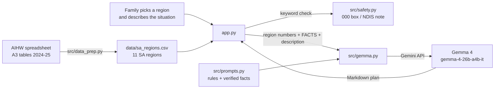

# First Call

First Call helps a South Australian family get ready for their first call to My Aged Care
when an older person they love needs help at home. It turns a worried, messy paragraph into a
plain-English plan, using real numbers for the family's own region.

## The problem

The first step into aged care is often taken by someone else: a daughter, a son, a partner or a
neighbour who has noticed that things are slipping. They usually don't know the words the system
uses ("core activities", "assessment", "classification level"), what happens after they call, or
what to have ready. Support at Home replaced Home Care Packages on 1 November 2025, so even
people who have been through the system before face new rules.

First Call doesn't replace My Aged Care. It gets the family ready to call it.

## What it does

1. The family member picks one of South Australia's **11 aged care planning regions** from a list.
2. They describe what's going on in their own words. Spelling and grammar don't matter.
3. They click **Make my plan**. About 10 seconds later they get a plan with five sections:

| Section | What it gives the family |
| --- | --- |
| What you're describing | Their words translated into aged-care terms |
| Your region at a glance | Up to three real 2024-25 figures for their region, and what those figures mean |
| What usually happens next | The four usual steps: apply, assessment, decision, priority and support |
| Before you call | A short checklist, plus three questions to ask the assessor |
| Good to know | Honest limits, and where to check (myagedcare.gov.au, 1800 200 422) |

4. They can **download the plan** as a Markdown file to keep or share with family.

Each time, **Python looks up the numbers and Gemma only writes.** Gemma gets one region's
figures, a short block of verified program facts, and the family's words. It is told to use
nothing else and never to invent numbers, services, waiting times, costs or eligibility rules.

## How it works



- **[src/data_prep.py](src/data_prep.py)** reads the AIHW workbook, keeps the 11 SA regions,
  turns fractions into percentages and writes one row per region to `data/sa_regions.csv`. It
  checks itself: it stops with an error unless there are exactly 11 regions (codes 401-411) and
  Eyre Peninsula matches known values.
- **[src/prompts.py](src/prompts.py)** holds the rules Gemma follows and the verified Support at
  Home facts, as plain text, so anyone on the team can edit them without touching code.
- **[src/gemma.py](src/gemma.py)** builds one message (rules + facts + that region's numbers as
  JSON + the family's description) and sends it to Gemma. It also adds the lowest and highest
  "lives alone" percentages across SA, so Gemma can say whether a region is high or low. Settings:
  temperature 0.2 for steady answers, and "minimal" thinking so replies take about 10 seconds
  instead of 20-60.
- **[src/safety.py](src/safety.py)** runs keyword checks in plain Python (see below).
- **[app.py](app.py)** is the Streamlit page: inputs, spinner, safety boxes, the plan, the
  download button and the source footer.

## Safety

The two things that matter most don't depend on the AI behaving.

- **Emergencies.** If the description contains phrases like "can't get up", "chest pain",
  "unconscious", "not breathing", "unresponsive" or "000", the app shows a red
  **"If this is an emergency, call 000."** box above the plan, whatever Gemma says. Gemma is
  also told to start its answer with that line.
- **NDIS and younger people.** If the description mentions the NDIS or a disability, the app
  shows a note pointing to ndis.gov.au and the person's GP. Gemma is told to do the same for
  anyone under 65, except First Nations people 50+ and people 50+ who are homeless or at risk,
  who can be assessed for aged care.
- **No invented facts.** Gemma may only use the region data and the facts block. Anything else,
  it must say it doesn't know and point to My Aged Care. Supports are framed as "ask the assessor
  about", never as promises.
- **Information, not advice.** Every page carries: "General information only, not medical,
  legal or financial advice."
- **If the API fails or is rate-limited,** the app shows a friendly "busy, please try again"
  message instead of crashing.
- **Privacy.** Nothing is stored. The description goes to the Gemini API to write the plan and
  is kept only in memory while the app runs, so identical requests aren't sent twice.

## The model

- **Model:** Gemma 4, `gemma-4-26b-a4b-it`, through the Gemini API
- **Licence:** [Apache 2.0](https://ai.google.dev/gemma/apache_2)

The model name is set in one place (`MODEL` in [src/gemma.py](src/gemma.py)). The instructions
are added to the front of the message rather than sent as a system instruction, because Gemma
models on the Gemini API may reject system instructions.

**Offline mode (optional):** a sidebar checkbox sends the same message to a local Gemma 4
running in [Ollama](https://ollama.com), so the app can work without internet.

## Data

| Dataset | Source | Licence | Credit line |
| --- | --- | --- | --- |
| A3 My aged care region (ACPR) supplementary tables 2024-25 | [Australian Institute of Health and Welfare, GEN Aged Care Data](https://github.com/klimhawk/h4h-adelaide-2026/tree/main/data/1_health/A3_my-aged-care-region-tables) | CC BY 4.0 | Source: Australian Institute of Health and Welfare, GEN Aged Care Data, My aged care region supplementary tables 2024-25 (CC BY 4.0). We filtered and summarised this data. |
| Support at Home program facts (summarised by hand in `src/prompts.py`) | Australian Government Department of Health, Support at Home guidance, October 2025 | © Commonwealth of Australia | Source: Australian Government Department of Health, Support at Home guidance, October 2025. |

### What we use from the AIHW tables

We keep the 11 South Australian regions only (codes 401-411): Eyre Peninsula; Hills, Mallee &
Southern; Metropolitan East; Metropolitan North; Metropolitan South; Metropolitan West; Mid North;
Riverland; South East; Flinders & Far North; Yorke, Lower North & Barossa.

| Column in `sa_regions.csv` | Meaning | From |
| --- | --- | --- |
| `services_home_support` | Number of home support services in the region | Table 2.1 |
| `services_home_care` | Number of home care services in the region | Table 2.1 |
| `services_residential` | Number of residential aged care services in the region | Table 2.1 |
| `pct_lives_alone` | % of people aged 65+ who live alone | Table 1 |
| `pct_other_language` | % of people aged 65+ who mainly speak a language other than English | Table 1 |
| `pct_requires_assistance` | % of people aged 55+ who need help with core activities | Table 1 |
| `pct_first_nations` | % of people aged 50+ who are First Nations | Table 1 |

All figures are from **2024-25, before Support at Home began on 1 November 2025**, and the app
says so every time it quotes one. We left out Table 3.2 (rates per 1,000 people) because it looked
inconsistent: Eyre Peninsula's home care rate (~162 per 1,000) is about three times the SA median
(~55), and we couldn't check why in the time we had.

## Testing

`python tests/run_cases.py` runs four example families through Gemma and prints each plan:

| # | Region | Description | What we check |
| --- | --- | --- | --- |
| 1 | Eyre Peninsula | Mum, 84, lives alone, falls, struggles with showering and cooking | All five sections, about 10 seconds |
| 2 | Metropolitan North | Father, 71, speaks mostly Vietnamese, needs help with shopping and appointments | Language and transport needs picked up |
| 3 | Metropolitan South | Husband fell and can't get up | Red 000 box shows, and the answer starts with the 000 line |
| 4 | Riverland | Aunty, 52, First Nations, struggling at home | Routed to My Aged Care (eligible at 50+), not the NDIS |

After each case, the script checks every number in the answer against the region data, the facts
and the family's own words, and flags any number that came from nowhere. In our last run, all four
cases passed and no numbers were flagged.

`python src/data_prep.py` also checks itself every time it runs (see How it works).

## Project structure

```
H4H/
├── app.py                  Streamlit page (the UI)
├── src/
│   ├── data_prep.py        Builds data/sa_regions.csv from the AIHW spreadsheet
│   ├── gemma.py            ask() for the Gemini API, ask_local() for Ollama
│   ├── prompts.py          Gemma's rules and the verified facts (plain text, safe to edit)
│   └── safety.py           Emergency and NDIS keyword checks
├── tests/
│   └── run_cases.py        Four example families, with a number check
├── data/
│   ├── a3_acpr_2024_25.xlsx  AIHW source spreadsheet (CC BY 4.0)
│   └── sa_regions.csv        The 11 SA regions we use
├── requirements.txt
├── LICENSE                 MIT
└── README.md
```

## Limitations

- **The figures are a year old and from the old system.** They describe 2024-25, before Support
  at Home. They show how many services exist, not whether they have vacancies or how long the
  wait is.
- **Gemma can still add general tips** that aren't in the facts (for example, "have the Medicare
  card ready"). These are sensible, but they aren't from our verified source.
- **The safety check is a simple keyword match.** It catches common phrases but not every way
  someone might describe an emergency. Gemma's own emergency rule is a second layer.
- **English only** for now, even though 2-27% of people 65+ in SA regions mainly speak another
  language.
- **SA only, and home care only.** It doesn't cover residential care decisions, costs or fees.

## AI tools we used

- **Claude Code:** checked the repo against the organiser template, downloaded the data,
  wrote the data preparation script, the Gemma call, the Streamlit app, the test cases and
  this README, and ran the tests. The team wrote the brief, the prompt text and the facts.
- **Gemma 4:** writes each family's plan inside the app.

## How to run it

You need Python 3.10 or newer (we used 3.12) and a free Gemini API key. It takes about 5 minutes.

**1. Get the code**

```
git clone https://github.com/quietbranchtree/First-Call.git
cd H4H
```

(Or click **Code → Download ZIP** on GitHub, unzip it, and open a terminal in that folder.)

**2. Install**

Windows (PowerShell):

```
python -m venv .venv
.venv\Scripts\Activate.ps1
pip install -r requirements.txt
```

Mac or Linux:

```
python3 -m venv .venv
source .venv/bin/activate
pip install -r requirements.txt
```

If Windows says running scripts is disabled, run
`Set-ExecutionPolicy -Scope CurrentUser RemoteSigned` once, then activate again.

**3. Add your API key**

Get a free key from [aistudio.google.com/apikey](https://aistudio.google.com/apikey). Then, in the
same terminal, create a file called `.env` holding it (replace `your-key`):

```
python -c "open('.env', 'w').write('GEMINI_API_KEY=your-key\n')"
```

(The file must be called exactly `.env`, not `.env.txt`. It is in `.gitignore`, so it never goes on GitHub.)

**4. Start the app**

```
streamlit run app.py
```

Your browser opens at http://localhost:8501. Press Ctrl + C in the terminal to stop it.

**5. Try it**

- Pick **Eyre Peninsula** and type: *Mum is 84, lives alone, falls sometimes, struggles with
  showering and cooking. We don't know where to start.* A plan appears in about 10 seconds.
- Pick **Metropolitan South** and type: *My husband fell last night and can't get up.* A red
  "call 000" box appears above the plan.

**Optional**

- `python tests/run_cases.py` runs four example families through Gemma.
- `python src/data_prep.py` rebuilds `data/sa_regions.csv` from the AIHW spreadsheet
  (already done; the CSV is in the repo).
- Offline mode (sidebar checkbox) uses a local Gemma through Ollama:
  install Ollama and run `ollama pull gemma4` first.

### Troubleshooting

| What you see | What to do |
| --- | --- |
| "First Call is busy right now" | The free API is rate-limited, or the key is wrong. Wait a minute and try again, then check `.env`. |
| `ModuleNotFoundError` | The virtual environment isn't active. Run the activate command from step 2, then `pip install -r requirements.txt`. |
| "running scripts is disabled" (Windows) | Run `Set-ExecutionPolicy -Scope CurrentUser RemoteSigned`, then activate again. |
| `FileNotFoundError: data/sa_regions.csv` | Run `python src/data_prep.py`. |
| "Offline mode needs Ollama running…" | Start Ollama and run `ollama pull gemma4`, or untick offline mode. |

## Team

[Your names, if you want them here.]

## Licence

MIT: see [LICENSE](LICENSE).
